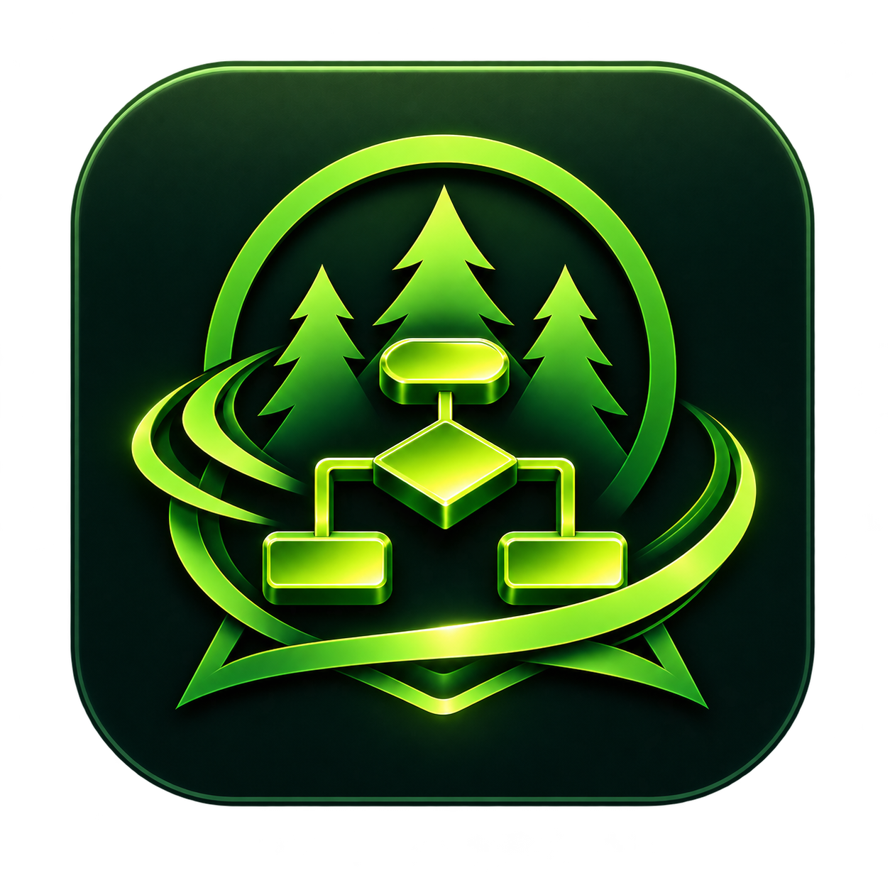
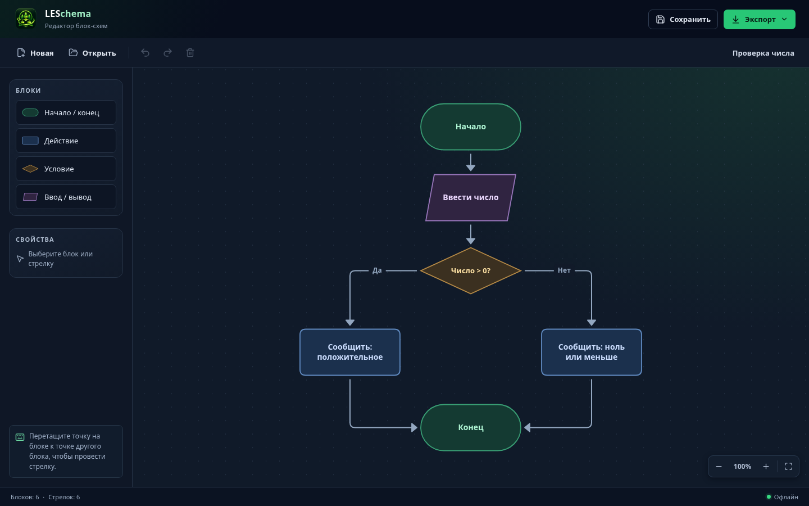

<div align="center">



# LESchema

**Офлайн-редактор блок-схем для Windows с сохранением проектов и экспортом изображений**

[](https://github.com/LES-Core/LESchema/releases)
[](https://dotnet.microsoft.com/download/dotnet/10.0)
[](https://www.typescriptlang.org/)
[](https://reactflow.dev/)
[](LICENSE)

</div>

---

## 📋 Содержание

- [📖 О проекте](#-о-проекте)
- [✨ Возможности](#-возможности)
- [📸 Скриншот](#-скриншот)
- [🚀 Быстрый старт](#-быстрый-старт)
- [🛠️ Сборка и разработка](#️-сборка-и-разработка)
- [📄 Лицензия](#-лицензия)
- [🧩 Другие проекты](#-другие-проекты)

## 📖 О проекте

**LESchema** — редактор блок-схем в стиле LES. При запуске `LESchema.exe` поднимает локальный сервер на `127.0.0.1` и открывает редактор в браузере. Файлы интерфейса и .NET входят в сборку, поэтому редактор работает без интернета сразу после запуска. Схемы хранятся в локальных файлах.

## ✨ Возможности

- **Фигуры** — действие, условие, начало и конец, подпрограмма, ввод и вывод, дисплей, цикл `for` и круглая ссылка-соединитель. Текст и комментарии можно размещать прямо на поле.
- **Редактор** — перемещение и изменение размеров блоков, стрелки с подписями, масштабирование, отмена и повтор действий.
- **Проекты** — сохранение схем в JSON и повторное открытие для редактирования.
- **Экспорт** — вся схема в PNG, JPG, SVG или WebP. WebP требует поддержки кодирования в браузере.
- **ProgramForYou** — выберите **Экспорт → JSON для ProgramForYou**, затем откройте этот файл в редакторе на сайте. Подписи стрелок переносятся как текстовые комментарии. Для дальнейшего редактирования в LESchema используйте **Сохранить**.

## 📸 Скриншот



## 🚀 Быстрый старт

1. Скачайте `LESchema.exe` для **Windows x64** из [раздела релизов](https://github.com/LES-Core/LESchema/releases) или соберите его по инструкции ниже.
2. Запустите файл двойным щелчком. Оставьте окно консоли открытым, пока редактируете схему.
3. Нажмите **Новая**. Добавьте блоки из панели слева и соедините их, перетащив точку с одного блока на другой. Чтобы изменить размер, выберите блок и потяните за угловой маркер. Выберите блок или стрелку, чтобы изменить текст в панели **Свойства**.
4. Нажмите **Сохранить**, чтобы скачать редактируемый JSON, или **Экспорт**, чтобы скачать изображение. После работы закройте окно консоли.

| Клавиши | Действие |
| --- | --- |
| `Ctrl+S` | Сохранить схему |
| `Ctrl+O` | Открыть JSON |
| `Ctrl+Z` | Отменить действие |
| `Ctrl+Y` | Повторить действие |
| `Delete` | Удалить выделенное |

## 🛠️ Сборка и разработка

Понадобятся Node.js 22.12 или новее и .NET SDK 10. Выполните из корня репозитория.

```sh
npm --prefix web ci
npm --prefix web run build
dotnet publish app/LESchema.csproj -c Release -r win-x64 --self-contained true -p:PublishSingleFile=true -p:IncludeNativeLibrariesForSelfExtract=true -p:EnableCompressionInSingleFile=true -p:DebugType=embedded -o artifacts/win-x64
```

Готовый файл появится в `artifacts/win-x64/LESchema.exe`. Для сборки под Windows на ARM замените `win-x64` на `win-arm64`.

- `app/` — приложение на C# и ASP.NET Core, которое запускает локальный сервер и открывает браузер.
- `web/` — интерфейс на React, TypeScript и React Flow. Команда `npm --prefix web run dev` запускает Vite для разработки.
- `screenshots/` — изображения для README.

Для проверки встроенного интерфейса соберите веб-часть, запустите `dotnet run --project app -- --no-browser` и откройте адрес из консоли.

## 📄 Лицензия

<div align="center">

Проект распространяется под лицензией **GNU General Public License v3**.

[](LICENSE)

**© 2026 LESchema**

</div>

---

## 🧩 Другие проекты

<div align="center">

Другие проекты можно посмотреть в организации **LES-Core**.

👉 **[github.com/LES-Core](https://github.com/LES-Core)**

</div>

---

<div align="center">

### ⭐ Если вам понравился проект, поставьте звёздочку на GitHub!

</div>
